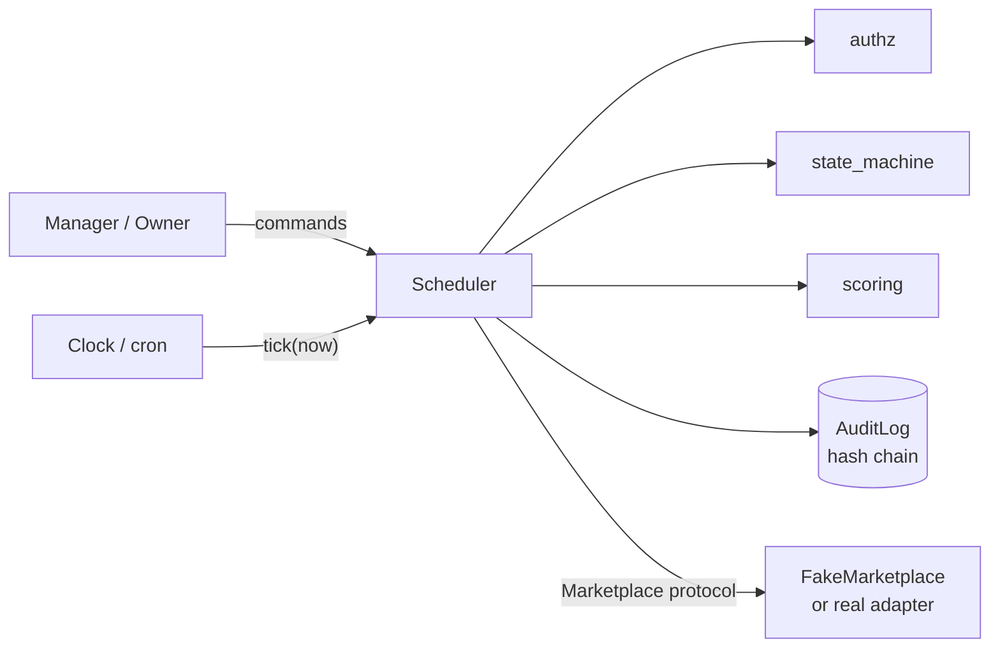
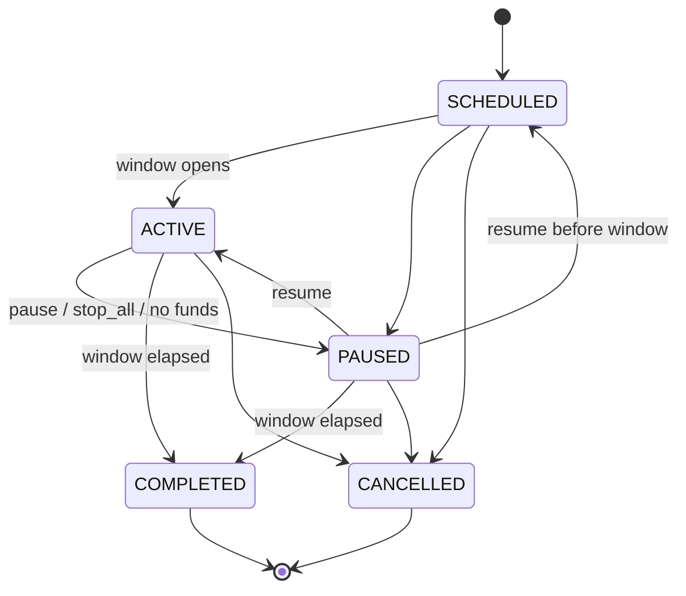

# boost-scheduler

A small, dependency-free Python library (plus a scripted simulation) that decides **when and which listing to "boost"** on a B2B marketplace for used industrial equipment (CNC machines, air compressors, forklifts...), while enforcing business rules around it.

It is a portfolio project built around patterns that matter in real operations software:

| Pattern | Where |
|---|---|
| Explicit **state machine** with a single transition table | `state_machine.py` |
| **Authorization** scoped by team (managers only touch their own experts) | `authz.py` |
| **All-or-nothing commands**: every precondition is checked first, all failures are reported together, nothing is mutated on rejection | `Scheduler.create_run` |
| **Explainable scoring** to pick the best of several similar listings | `scoring.py` |
| **Tamper-evident audit log** (SHA-256 hash chain), rejected commands included | `audit.py` |
| **Ports & adapters**: the scheduler talks to a `Marketplace` protocol, not to HTTP | `marketplace.py` |
| **Deterministic time**: `now` is always injected, never read from the clock | everywhere |

> **Disclaimer:** the dealer, machine brands ("Vortex", "Helix"), people and numbers are entirely fictional. No real marketplace, company or customer data is used or contacted.

## The problem

An industrial-equipment dealer advertises each used machine through several sales engineers (the code calls them *experts*). On the marketplace, search results are ordered by *most recently boosted*, and every boost is paid from a prepaid dealer wallet (a "panel") that can be shared between teams.

A manager starts a **run**: a machine, a **plan**, an ordered list of engineers and a time window.

* A **plan** is "boost again once *N* competitor listings have overtaken our best-ranked listing" (`aggressive`=1, `standard`=3, `relaxed`=5).
* When the trigger fires, the scheduler picks **which expert's listing** to boost using a weighted score of listing quality, time since last boost and performance (views and calls).
* Several runs can be active at once (one live run per machine). Runs can be paused, resumed, cancelled or replaced.
* A manager may act only on engineers of their own team ("metalworking" or "utilities" in the sample data); the owner may act on everyone and can issue a global stop.
* Wallets are checked: the scheduler warns when a wallet is low and pauses a run automatically when it cannot pay.

## Architecture



## Quick start (WSL Ubuntu + VS Code + uv)

```bash
# 1) install uv once (skip if you already have it)
curl -LsSf https://astral.sh/uv/install.sh | sh

# 2) clone and enter the project, then open it in VS Code from WSL
cd boost-scheduler
code .

# 3) create the virtualenv and install dev tools
uv sync

# 4) run the simulation
uv run boost-demo                     # same as: uv run python -m boost_scheduler
uv run boost-demo --seed 42 --hours 8 --audit-out audit.jsonl

# 5) tests, lint, format
uv run pytest
uv run ruff check .
uv run ruff format .
```

In VS Code pick the interpreter `.venv/bin/python` (already preselected by `.vscode/settings.json`) and install the recommended extensions (Python, Ruff). The test explorer discovers the `tests/` folder automatically.

The runtime has **no third-party dependencies**; `pytest` and `ruff` are dev-only (`[dependency-groups]` in `pyproject.toml`). Commit the `uv.lock` file that `uv sync` generates.

## What the simulation prints

It plays a six-hour morning at the dealer: valid and invalid commands, automatic boosts, a manual pause/resume, a replacement, a wallet running low, and a global stop.

```text
Machines on sale:
  cnc-01   Vortex CNC-300 turning center (2019, 11,000 h)
  comp-02  Helix RS-75 screw air compressor (2021, 7,500 h)

09:00  OK         manager-metal creates run for the CNC lathe (standard)
09:00  DENIED     manager-utilities tries to use a metalworking engineer
           -> manager 'manager-utilities' (team 'utilities') cannot act on experts outside their team: nora
09:00  REJECTED   manager-utilities submits an invalid command
           -> unknown expert: ghost
           -> unknown plan: turbo
           -> window end must be after window start
           -> window end is already in the past
09:00  OK         manager-utilities creates run for the compressor (aggressive)
09:05  SYSTEM     run_started run-1
09:05  BOOST      run-1  cnc-01-omar     rank_before=8  score=0.660  cost=10
09:20  BOOST      run-1  cnc-01-nora     rank_before=3  score=0.600  cost=10
...
12:30  OK         manager-utilities replaces run-2 with a relaxed plan
12:30  SYSTEM     run_started run-3
12:35  BOOST      run-1  cnc-01-nora     rank_before=3  score=0.638  cost=10
12:55  SYSTEM     low_balance_warning run-3 20
12:55  BOOST      run-3  comp-02-ravi    rank_before=5  score=0.660  cost=10
13:00  BOOST      run-1  cnc-01-omar     rank_before=4  score=0.698  cost=10
13:15  BOOST      run-1  cnc-01-omar     rank_before=3  score=0.598  cost=10
13:30  OK         owner issues a global stop  -> paused ['run-1', 'run-3']
14:00  SYSTEM     run_completed run-1 window_elapsed
15:00  SYSTEM     run_completed run-3 window_elapsed

=== Summary ===
run-1: machine=cnc-01 plan=standard   status=completed boosts=10 spent=100
run-2: machine=comp-02 plan=aggressive status=cancelled boosts=19 spent=190
run-3: machine=comp-02 plan=relaxed    status=completed boosts=1 spent=10
panel-1 balance: 260
panel-2 balance: 0
audit events: 47  chain valid: True
```

Things to notice in that output:

* `DENIED`: a manager tried to command another team's engineer.
* `REJECTED`: an invalid command, with **every** reason listed at once.
* `SYSTEM`: automatic lifecycle events (start, completion, low-balance warning).
* `chain valid: True`: the audit log verifies end to end.

## Sample data (all fictional)

Defined in `src/boost_scheduler/sample_world.py` and shared by the demo and the tests.

| Entity | Values |
|---|---|
| Machines for sale | `cnc-01` Vortex CNC-300 turning center (2019), `comp-02` Helix RS-75 screw air compressor (2021) |
| Teams | `metalworking` (Nora, Omar), `utilities` (Lena, Ravi) |
| Actors | `owner`, `manager-metal`, `manager-utilities` |
| Wallets | `panel-1` (300 units) and `panel-2` (260 units), shared across teams; one boost costs 10 |
| Competition | 8 rival listings per machine with staggered boost times, plus a seeded random generator for rival boosts, views and calls |

Swap this module (and the `MACHINES` mapping) to model another catalogue; the scheduler itself knows nothing about CNC machines.

## Rules at a glance

| Rule | Behaviour |
|---|---|
| Trigger | boost when `rank(best own listing) >= plan.passes_required` |
| Candidate choice | highest weighted score; ties follow the manager's expert order |
| Cooldown | a listing is never boosted twice within `min_boost_interval` (default 5 min) |
| Wallet | warn once below the threshold; auto-pause (by `system`) when it cannot pay |
| One live run per machine | a new run needs `replace=True`, which also requires authority over the old run |
| Window | a run activates at `start`, completes at `end`; paused runs still complete |
| Commands | validated first; on any failure nothing changes and the rejection is audited |

Run lifecycle:



## Using it as a library

```python
from datetime import UTC, datetime, timedelta

from boost_scheduler import Scheduler
from boost_scheduler.sample_world import EXPERTS, MANAGER_A, build_world

now = datetime(2026, 1, 12, 9, 0, tzinfo=UTC)
world = build_world(now)
scheduler = Scheduler(market=world.market, experts=EXPERTS)

run = scheduler.create_run(
    MANAGER_A, machine_id="cnc-01", plan_name="standard",
    expert_ids=["nora", "omar"], start=now, end=now + timedelta(hours=4), now=now,
)
for record in scheduler.tick(now):
    print(record.listing_id, record.rank_before, record.score)
```

To connect a real marketplace, implement the `Marketplace` protocol (`listings_for_machine`, `rank_of`, `boost_cost`, `balance`, `boost`) and pass it as `market=`. Nothing else changes.

## Project layout

```text
boost-scheduler/
├── pyproject.toml            # uv / hatchling / pytest / ruff config
├── src/boost_scheduler/
│   ├── models.py             # dataclasses and enums
│   ├── errors.py             # exception hierarchy
│   ├── state_machine.py      # run lifecycle table
│   ├── authz.py              # team-scoped authorization
│   ├── scoring.py            # explainable listing scoring
│   ├── audit.py              # hash-chained audit log
│   ├── marketplace.py        # Marketplace protocol + FakeMarketplace
│   ├── scheduler.py          # commands + tick loop
│   ├── sample_world.py       # fictional data shared by demo and tests
│   └── cli.py                # scripted simulation (boost-demo)
└── tests/                    # state machine, authz, scoring, audit, scheduler
```

## Design notes

* **Why inject `now`?** Scheduling logic that reads the wall clock is hard to test. Here a six-hour simulation runs in milliseconds and is reproducible: the same seed yields the same boosts and the same final audit hash (there is a test for that).
* **Why collect all precondition failures?** An operator fixing a rejected command should see everything wrong in one go instead of discovering problems one retry at a time.
* **Why audit rejections?** "Who tried to do what, and why was it refused?" is often the first question after an incident.
* **Hash chain limits:** it detects edits, deletions and re-ordering of stored events. It does not stop someone who can rewrite the whole log; for that, publish the latest `head_hash` somewhere external.
* **Trade-offs:** state lives in memory and ticks are driven externally. Those are deliberate simplifications to keep the demo readable.

## Ideas for extension

* Persist runs and audit events in SQLite or PostgreSQL (the hash chain maps naturally onto an append-only table).
* Drive `tick()` with APScheduler, a cron job or an asyncio loop.
* Expose the commands through FastAPI and add real authentication.
* Add a "peak hours" weighting to the trigger using historical views and calls.

## License

MIT, see `LICENSE`.
